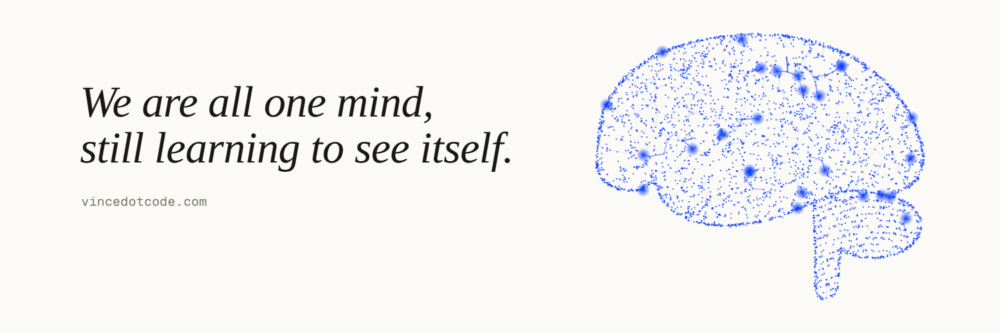

## Hi, I'm Vince.

I study how minds come to be, in people and in machines, and I ship the systems.
I'm an AI researcher and engineer in Mauritius, and I still can't stop asking what's
actually going on inside the models I build.

[vincedotcode.com](https://www.vincedotcode.com) · [X](https://x.com/vinceerkadoo) · [LinkedIn](https://www.linkedin.com/in/vinceerkadoo) · vince@vincedotcode.com

---

### Now

- **CTO (consulting), [Nourishubs](https://www.nourishubs.com).** A food platform that
  started with school meals and now also serves early learning centres and
  organisations. I own the architecture and led the ISO 27001 work.
- **Founder, [Bienzoli](https://www.bienzoli.com).** POS, invoicing and stock for small
  businesses in Mauritius. I build and run it myself.
- **Senior Software Engineer, SD Worx.** Since 2024.

### Research

- **Living Base Models** (draft, Oct 2026). I took the assistant script away from a
  language model and asked what it says about itself. I found no evidence of
  experience, and the paper says so plainly. I'm not done looking.
- **Probes and small minds.** Activation probes, direction ablation, small
  Transformers trained from scratch. Every failed attempt stays on the record.
- **Sunday.** My own AI, living on a loop with goals it sets itself. I'm building it
  to find out how much of an inner life can be engineered, and where that stops.

### Selected work

| Project | What it is |
|---|---|
| [monature](https://github.com/vincedotcode/monature) | Environmental campaigns platform. Winner, IEEE Web Hackathon 2024 |
| [motalent](https://github.com/vincedotcode/motalent) | HR platform: vacancies, recruitment pipeline end to end |
| [mopet](https://github.com/vincedotcode/mopet) | Pet adoption and donation platform with vet-finder |
| [mokidsafe](https://github.com/vincedotcode/mokidsafe) | Child safety app, React Native: real-time location and geofencing |

40+ projects since 2020, in four countries. Case studies on [my site](https://www.vincedotcode.com/cases).

### Certifications

- Microsoft Certified: Azure Fundamentals (AZ-900), 2023
- Neo4j Certified Professional, 2023
- Google Project Management Professional Certificate, 2024
- Certified Associate in Scrum Fundamentals (CASF), 2024
- Future FinTech Champion, Mauritius Africa FinTech Hub, 2024–25

### Stack

`TypeScript` `Python` `C#/.NET` · `Next.js` `React` `React Native` `NestJS`
`PostgreSQL` `MongoDB` `Prisma` `Redis` · `AWS EKS` `Azure` `Docker` `Kubernetes`
